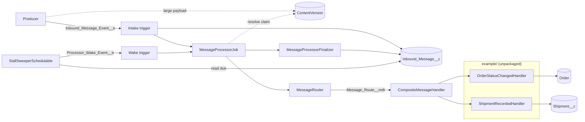

# apex-event-ingestion

[](https://github.com/csquaredaz/apex-event-ingestion/actions/workflows/ci.yml)


## The problem

Integrations deliver messages at least once. Producers retry, Platform Events redeliver, and a Queueable can die on an uncatchable governor limit halfway through a batch. The obvious approach, handling each event in its trigger, processes duplicates twice, loses the messages a failed job had claimed, and gives no record of what arrived or why it failed. This repo makes ingestion idempotent and recoverable: every message is written once to a message store keyed by the producer's idempotency key, dispatched to bulk Command handlers routed by Custom Metadata, recovered by a Transaction Finalizer when a job fails, and swept by a scheduled stall detector. Large payloads travel by Claim Check. The design is informed by production experience at scale.

## Architecture



Everything outside `example/` is the package (`force-app/`, by feature: `store`, `dispatch`, `processing`, `intake`, `claim`, `stall`). `example/` is an unpackaged subscriber-org sample: two handlers on one message type, so the route is a Composite.

## Quick start

```bash
npm ci
npm run org:setup
npm run org:test
```

Requires the Salesforce CLI and a Dev Hub set as the default (`sf config set target-dev-hub=<alias>`). `org:setup` creates a scratch org, installs apex-core-lib `1.1.0-1`, deploys the package and `example/`, and assigns every permission set to you. `org:test` runs this repo's own test classes, the same set CI runs.

Two more steps make a real org self-healing. An unlocked package can't run a post-install script, so they are manual:

1. Assign `Event_Ingestion_Sweeper` to the user who will schedule the stall sweeper, plus whatever your `IAlertSink` binding needs (apex-platform-logging's Slack sink needs principal access on its External Credential).
2. As that user, schedule the sweeper: `npm run org:schedule-sweeper -- --target-org <alias>`. It adds four jobs (`:00`, `:15`, `:30`, `:45`); running it twice fails with "already scheduled" and changes nothing.

The Automated Process user stores and processes every message, with no permission set (ADR 0007). Producers need `Event_Ingestion_Publisher`; operators get `Event_Ingestion_Viewer`.

Then try it: publish the event in [Usage](#usage) for an order whose `OrderReferenceNumber` is `ORD-1042`, and within seconds the order's `Fulfilment_Status__c` reads `Shipped` and a `Shipment__c` exists.

## Usage

Producers publish an event (the running user needs the `Event_Ingestion_Publisher` permission set). The intake trigger stores each message once, as the Automated Process user, and starts processing:

```apex
EventBus.publish(
  new Inbound_Message_Event__e(
    Source__c = 'erp',
    External_Message_Id__c = 'ORD-1042-shipped',
    Message_Type__c = 'order.status_changed',
    Occurred_At__c = Datetime.now(),
    Payload__c = '{"orderNumber":"ORD-1042","status":"Shipped","carrier":"Acme Freight","trackingNumber":"1Z-1042"}'
  )
);
```

A payload over `Payload__c`'s 131,072 characters travels by claim check: the producer uploads it as a file and sends the version Id instead. The claim is accepted only when the same user uploaded that version, and the file is at most `Claim_Max_Bytes__c` (3,000,000 bytes by default). Handlers get the file's text from `InboundMessage.getPayload()` as usual:

```apex
ContentVersion file = new ContentVersion(
  Title = 'ORD-1042 lines',
  PathOnClient = 'ord-1042.json',
  VersionData = Blob.valueOf(largeJson)
);
insert file;
EventBus.publish(
  new Inbound_Message_Event__e(
    Source__c = 'erp',
    External_Message_Id__c = 'ORD-1042-lines',
    Message_Type__c = 'order.lines_replaced',
    Payload_Ref__c = file.Id
  )
);
```

Apex producers that want a result per message can call the store directly instead (the running user needs `Event_Ingestion_Processor`):

```apex
// Store a batch of producer messages once each. Redeliveries come back as duplicates.
IMessageStore store = (IMessageStore) Application.Service.newInstance(IMessageStore.class);
List<AppendResult> results = store.append(
  new List<Inbound_Message__c>{
    new Inbound_Message__c(
      Source__c = 'erp',
      External_Message_Id__c = 'ORD-1042-shipped',
      Message_Type__c = 'order.status_changed',
      Payload__c = '{"orderNumber":"ORD-1042","status":"Shipped"}'
    )
  }
);
for (AppendResult result : results) {
  // ACCEPTED (new row), DUPLICATE (already stored; getMessageId() is the stored row) or REJECTED (getError()).
  System.debug(result.getOutcome() + ' ' + result.getIdempotencyKey());
}
```

Then start processing. At most one processor job is queued at a time, so it's safe to call after every batch; outcomes and retries are recorded on each row (`Status__c`, `Attempts__c`, `Next_Attempt_At__c`, `Last_Error__c`):

```apex
MessageProcessing.enqueue();
```

The sweeper (Quick start, step 2) runs every 15 minutes, wakes processing for retries and lost runs, and sends a WARNING alert when a message has been due for more than 30 minutes.

### Handling a message type

A handler is a bulk Command: `IMessageHandler.handle(List<InboundMessage>)` returns one `HandlerResult` per message: `SUCCESS`, `RETRYABLE` (a later attempt might work) or `FATAL` (it never will). Name it in a `Message_Route__mdt` row; two rows for one type make a Composite, run in `Order__c` order, where the worst result per message wins. The contract, from `IMessageHandler`: be idempotent, assume no order, make no synchronous callouts, and report rather than throw.

[`example/`](example/orders) shows all of it on `order.status_changed`:

| Route `Order__c` | Handler                     | Does                                                                                                                                    |
| ---------------- | --------------------------- | --------------------------------------------------------------------------------------------------------------------------------------- |
| 10               | `OrderStatusChangedHandler` | Upserts the order's `Fulfilment_Status__c` keyed on `OrderReferenceNumber`; skips a change older than `Status_Changed_At__c` (ADR 0005) |
| 20               | `ShipmentRecordedHandler`   | On `Shipped`, upserts a `Shipment__c` keyed on the unique `Tracking_Number__c`, so a resent message updates the same shipment           |

Both extend `OrderMessageHandler` (Template Method), which parses every payload, finds the orders in one query and answers the common cases: an unparseable payload is `FATAL`, an unknown order is `RETRYABLE` (it may not have arrived yet), and a reference number shared by two orders is `FATAL`. The subclass applies the rest with one Unit of Work commit:

```apex
protected override List<HandlerResult> apply(List<OrderStatusChange> changes, Map<String, Order> orderByNumber) {
  List<HandlerResult> results = new List<HandlerResult>();
  Map<String, OrderStatusChange> newestByNumber = new Map<String, OrderStatusChange>();
  for (OrderStatusChange change : changes) {
    String orderKey = key(change.getOrderNumber());
    OrderStatusChange current = newestByNumber.get(orderKey);
    Boolean stale = change.getMessage().isOlderThan(orderByNumber.get(orderKey).Status_Changed_At__c);
    if (!stale && (current == null || !change.isOlderThan(current))) {
      newestByNumber.put(orderKey, change);
    }
    // Every change succeeds: a stale or superseded one is handled by doing nothing.
    results.add(HandlerResult.success(change.getMessage().getMessageId()));
  }
  // … one registerUpsert(…, Order.OrderReferenceNumber) and one commitWork() for the newest per order.
  return results;
}
```

`example/` is not part of the package. It's a second package directory, so `org:setup` deploys it and CI tests and gates it like the package (ADR 0001), while `sf package version create` builds only `force-app/`. To use the package in your own org, write handlers like these in your org's source and add route rows; no new package version is needed.

## Design decisions

| Decision      | Choice                                                                                                                                                                                                                                                                                       | Rejected alternative                                                      | ADR                                                        |
| ------------- | -------------------------------------------------------------------------------------------------------------------------------------------------------------------------------------------------------------------------------------------------------------------------------------------- | ------------------------------------------------------------------------- | ---------------------------------------------------------- |
| Distribution  | Own unlocked package on apex-core-lib 1.1.0-1                                                                                                                                                                                                                                                | Source-only repo; a module inside apex-core-lib                           | [0001](docs/adr/0001-apex-event-ingestion-distribution.md) |
| Message store | Custom object `Inbound_Message__c` with a status lifecycle, OWD Private, Processor and Viewer permission sets                                                                                                                                                                                | Big Object; no store, relying on event replay                             | [0002](docs/adr/0002-message-store.md)                     |
| Idempotency   | Producer key `Source:ExternalId` in a unique, case-sensitive field; partial-success insert in user mode, duplicates classified by `DUPLICATE_VALUE`                                                                                                                                          | Payload hash; query-then-insert; upsert on the key                        | [0003](docs/adr/0003-producer-idempotency-key.md)          |
| Dispatch      | Bulk Command `IMessageHandler` routed by `Message_Route__mdt`; several routes form a Composite where the worst result wins; each handler is guarded by a savepoint (so no synchronous callouts)                                                                                              | One call per message; Chain of Responsibility; no savepoint               | [0004](docs/adr/0004-command-composite-dispatch.md)        |
| Ordering      | No ordering guarantee; handlers skip stale updates with `InboundMessage.isOlderThan`                                                                                                                                                                                                         | Per-record sequencing; a single ordered job                               | [0005](docs/adr/0005-no-ordering-guarantee.md)             |
| Recovery      | `MessageProcessorJob` claims a batch with a `FOR UPDATE` row lock, dispatches and records outcomes in one transaction; its Finalizer recovers a failed job's messages (`Failed` with exponential backoff, or `Dead`) and enqueues the next run; one duplicate signature keeps one job queued | A stored `Processing` status; two jobs per batch; chaining from `execute` | [0006](docs/adr/0006-queueable-finalizer-recovery.md)      |
| Intake        | High-volume `Inbound_Message_Event__e` (Publish After Commit); the trigger takes up to 200 events or 3,000,000 payload characters per run with a resume checkpoint, retries every failure and alerts on the last retry; stored and processed by the Automated Process user                   | Direct store calls only; an Apex REST endpoint; giving up after 3 retries | [0007](docs/adr/0007-platform-event-intake.md)             |
| Claim Check   | A payload over 131,072 characters travels as a `ContentVersion` Id in `Payload_Ref__c`; the store accepts it only from the user who uploaded that version, within 3,000,000 bytes; one processor job dispatches at most 4,000,000 payload characters and bytes                               | Trusting file visibility; a link to the message record; a library         | [0008](docs/adr/0008-claim-check.md)                       |
| Stall sweep   | Four 15-minute schedules read due messages and publish `Processor_Wake_Event__e`, so the job runs as the Automated Process user; one WARNING per sweep for messages due over 30 minutes                                                                                                      | Enqueue as the scheduler with Modify All; system-mode status writes       | [0009](docs/adr/0009-stall-sweeper.md)                     |
| Example       | Unpackaged `example/` as a second package directory: deployed by `org:setup`, tested and gated by CI with the package, never in the package version; ships a permission set and no profile                                                                                                   | A separate CI deploy step; excluding it from the coverage gate            | [0001](docs/adr/0001-apex-event-ingestion-distribution.md) |

## Testing

| Layer                       | What it proves                                                                                                                                                                                   | Run it             |
| --------------------------- | ------------------------------------------------------------------------------------------------------------------------------------------------------------------------------------------------ | ------------------ |
| Apex unit (Stub API mocks)  | Each class's behaviour in isolation: selectors, the store, dispatch, the lifecycle, the job and Finalizer (with a fake `FinalizerContext`), intake, claims, the sweeper and the example handlers | `npm run org:test` |
| Apex integration (real DML) | Real event deliveries through the trigger, store, job and lifecycle, as Minimum Access users with and without each permission set; 200-record bulk cases                                         | `npm run org:test` |
| End to end                  | `IngestionEndToEndTest`: publish → store → Composite dispatch → `Order` and `Shipment__c` written, with nothing mocked: bulk, redelivery, stale, unknown-order and worst-result-wins cases       | `npm run org:test` |
| Static analysis             | Zero High or Critical Code Analyzer findings (CI gate); this repo also keeps zero Moderate                                                                                                       | `npm run analyze`  |

`org:test` runs only this repo's `*Test` classes (`--class-names`), because `RunLocalTests` would also run apex-core-lib's packaged tests (ADR 0001). CI does the same in a fresh scratch org on every non-draft PR and fails unless every test passes and coverage of this repo's own classes, the package's and `example/`'s, is at least 90%; it's 100%. Tests cover what coverage can't: a Finalizer that can't be forced to fail in a test is driven with a fake context, the Automated Process user's access is exercised through real deliveries, and a mutation check per feature (the payload truncation, the uploader check, the wake call, the stale guard) confirmed the tests fail when the behaviour goes. There's no LWC, so `npm run test:unit` has nothing to run.

Deliberately left out, because this repo is free only: coverage SaaS (the badge is a shields.io endpoint on the `badges` branch), paid scanners and any CI step that calls a model.

## Built with Claude Code

- **Standards:** this repo's [`CLAUDE.md`](CLAUDE.md) and the [`apex-standards`](https://github.com/csquaredaz/claude-code-salesforce-skills) plugin: `apex-fflib-layers` (layers, DI, Unit of Work), `apex-security` (user mode, sharing, least-privilege tests), `apex-testing` (behaviour names, Stub API, bulk and negative cases) and `apex-code-review` (run on every PR before it leaves draft). The workspace rules add: plan first, verify platform facts with a throwaway probe before relying on them, one scratch org per PR, and the owner approves every design call and merges every PR.
- **One concrete example: the Claim Check's confused deputy (PR #6, ADR 0008).** The plan left one question open: how the processor would get access to a producer's file (a share, a link to the message, or a library). Before building, Claude Code wrote and ran a probe in a scratch org as the Automated Process user, the user that stores every event-borne message. It showed that this user reads _every_ `ContentVersion` in user mode, including files no one shared with it. So anyone allowed to publish an event could have had the processor read any file in the org and hand it to a handler. Claude Code stopped and put three options to the owner; the approved fix accepts a claim only when `ContentVersion.CreatedById` is the event's publisher (`PayloadClaim.problemFor`, commit `a642be5`).
- **How it was reviewed:** the probe's raw output went into the handoff and ADR 0008 before any code. The owner chose the option. `apex-code-review` ran on the diff before the PR left draft. A mutation check removed the uploader check and five tests failed, including an end-to-end rejection through a real event delivery, which shows the tests guard it. CI then ran the whole suite in a fresh scratch org, and the owner merged in the GitHub UI.
- **Every AI-assisted commit** carries a `Co-Authored-By: Claude` trailer and goes through a PR with the same gates as any other change.

## License

MIT
