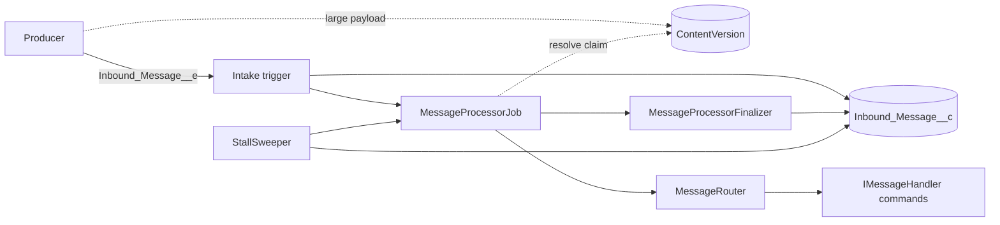

# apex-event-ingestion

[](https://github.com/csquaredaz/apex-event-ingestion/actions/workflows/ci.yml)


## The problem

Integrations deliver messages at least once. Producers retry, Platform Events redeliver, and a Queueable can die on an uncatchable governor limit halfway through a batch. The obvious approach, handling each event in its trigger, processes duplicates twice, loses the messages a failed job had claimed, and gives no record of what arrived or why it failed. This repo makes ingestion idempotent and recoverable: every message is written once to a message store keyed by the producer's idempotency key, dispatched to bulk Command handlers routed by Custom Metadata, recovered by a Transaction Finalizer when a job fails, and swept by a scheduled stall detector. Large payloads travel by Claim Check. The design is informed by production experience at scale.

## Architecture



## Quick start

```bash
npm ci
npm run org:setup
npm run org:test
```

Requires the Salesforce CLI and a Dev Hub set as the default (`sf config set target-dev-hub=<alias>`).

## Usage

```apex
// Store a batch of producer messages once each. Redeliveries come back as duplicates.
IMessageStore store = (IMessageStore) Application.Service.newInstance(IMessageStore.class);
List<AppendResult> results = store.append(
  new List<Inbound_Message__c>{
    new Inbound_Message__c(
      Source__c = 'erp',
      External_Message_Id__c = 'ORD-1042-shipped',
      Message_Type__c = 'order.status_changed',
      Payload__c = '{"orderNumber":"ORD-1042","status":"Shipped"}'
    )
  }
);
for (AppendResult result : results) {
  // ACCEPTED (new row), DUPLICATE (already stored; getMessageId() is the stored row) or REJECTED (getError()).
  System.debug(result.getOutcome() + ' ' + result.getIdempotencyKey());
}
```

Then start processing. At most one processor job is queued at a time, so it's safe to call after every batch; outcomes and retries are recorded on each row (`Status__c`, `Attempts__c`, `Next_Attempt_At__c`, `Last_Error__c`):

```apex
MessageProcessing.enqueue();
```

Handle a message type with a bulk Command, then route it with a `Message_Route__mdt` row (`Message_Type__c = order.status_changed`, `Handler_Class__c = OrderStatusChangedHandler`):

```apex
public with sharing class OrderStatusChangedHandler implements IMessageHandler {
  public List<HandlerResult> handle(List<InboundMessage> messages) {
    List<HandlerResult> results = new List<HandlerResult>();
    for (InboundMessage message : messages) {
      // Parse, then apply in bulk after the loop. Idempotent, order-free, no synchronous callouts.
      results.add(HandlerResult.success(message.getMessageId()));
    }
    return results;
  }
}
```

## Design decisions

| Decision      | Choice                                                                                                                                                                                                                                                                                       | Rejected alternative                                                      | ADR                                                        |
| ------------- | -------------------------------------------------------------------------------------------------------------------------------------------------------------------------------------------------------------------------------------------------------------------------------------------- | ------------------------------------------------------------------------- | ---------------------------------------------------------- |
| Distribution  | Own unlocked package on apex-core-lib 1.1.0-1                                                                                                                                                                                                                                                | Source-only repo; a module inside apex-core-lib                           | [0001](docs/adr/0001-apex-event-ingestion-distribution.md) |
| Message store | Custom object `Inbound_Message__c` with a status lifecycle, OWD Private, Processor and Viewer permission sets                                                                                                                                                                                | Big Object; no store, relying on event replay                             | [0002](docs/adr/0002-message-store.md)                     |
| Idempotency   | Producer key `Source:ExternalId` in a unique, case-sensitive field; partial-success insert in user mode, duplicates classified by `DUPLICATE_VALUE`                                                                                                                                          | Payload hash; query-then-insert; upsert on the key                        | [0003](docs/adr/0003-producer-idempotency-key.md)          |
| Dispatch      | Bulk Command `IMessageHandler` routed by `Message_Route__mdt`; several routes form a Composite where the worst result wins; each handler is guarded by a savepoint (so no synchronous callouts)                                                                                              | One call per message; Chain of Responsibility; no savepoint               | [0004](docs/adr/0004-command-composite-dispatch.md)        |
| Ordering      | No ordering guarantee; handlers skip stale updates with `InboundMessage.isOlderThan`                                                                                                                                                                                                         | Per-record sequencing; a single ordered job                               | [0005](docs/adr/0005-no-ordering-guarantee.md)             |
| Recovery      | `MessageProcessorJob` claims a batch with a `FOR UPDATE` row lock, dispatches and records outcomes in one transaction; its Finalizer recovers a failed job's messages (`Failed` with exponential backoff, or `Dead`) and enqueues the next run; one duplicate signature keeps one job queued | A stored `Processing` status; two jobs per batch; chaining from `execute` | [0006](docs/adr/0006-queueable-finalizer-recovery.md)      |

## Testing

| Layer                       | What it proves                                        | Run it              |
| --------------------------- | ----------------------------------------------------- | ------------------- |
| Apex unit (Stub API mocks)  | Service and domain behaviour in isolation             | `npm run org:test`  |
| Apex integration (real DML) | Trigger → service → commit, as a least-privilege user | `npm run org:test`  |
| Static analysis             | Zero High or Critical Code Analyzer findings          | `npm run analyze`   |
| LWC (Jest)                  | Component behaviour                                   | `npm run test:unit` |

CI runs every layer on each PR in a fresh scratch org, then deletes the org.

## Built with Claude Code

- **Standards:** this repo's [`CLAUDE.md`](CLAUDE.md) and the [`apex-standards`](https://github.com/csquaredaz/claude-code-salesforce-skills) plugin (`apex-fflib-layers`, `apex-security`, `apex-testing`, `apex-code-review`).
- **One concrete example:** <!-- what Claude Code drafted, what the review caught or changed, and the commit or PR where it happened. -->
- **How AI work is reviewed:** every AI-assisted commit carries a `Co-Authored-By: Claude` trailer, goes through a PR with CI, and is reviewed against the same standards.

## License

MIT
